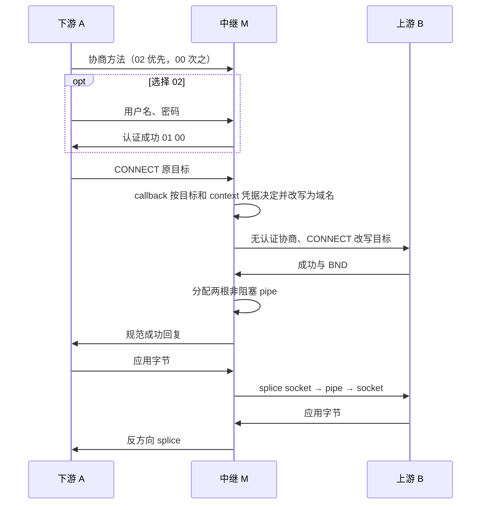

# SOCKS5 目标改写中继架构

更新：2026-10-24。TCP、入站凭据收集和可选的客户端认证已实现；UDP 保留契约，暂不实现。
当前可调用 API 和使用示例见 [README](../README.md)。

## 1. 范围与原则

Python 3.14，uv 管理，供其他网络项目导入，Linux 运行。
A 为下游客户端，M 为本模块中继，B 为指定外部 SOCKS5 服务器。
M 仅向 B 建连，不直接连接目标；业务路由由 callback 决定。

当前支持 TCP CONNECT：A 请求 IPv4、IPv6 或 DOMAIN，callback 成功后总是返回 DOMAIN，
M 用该域名和端口向 B 发 CONNECT。成功后 payload 逐字节透传。
BIND 和 UDP ASSOCIATE 回复 `0x07`，不调用 callback。

协议策略采用宽进严出：允许不影响解析的非零 RSV、方法列表中的其他方法、
域名大小写、下划线、末尾点及 DOMAIN 类型的数字字符串；入站 UTF-8 域名转换为 IDNA。
不因为保留字节异常拒绝有效请求；发出的握手和回复始终采用正确版本、长度和零 RSV。
无法解析的地址、非法端口、不支持的版本/认证方法仍明确失败。

TCP CONNECT 成功回复中的 BND 地址描述上游绑定端点，不是 callback 的目标逆映射。
M 转发 B 的 BND 类型、地址和端口，重新编码为规范 SOCKS5 回复；不对它调用 reverse。
上游失败 REP 保留，包括可解析的未知非零 REP；失败回复即使没有完整 BND 也可接受，
M 对 A 发出完整的全零 BND 失败回复。

## 2. 模块和对象

| 模块 | 职责 |
| --- | --- |
| `models.py` | 不可变地址、callback 上下文、选项及类型契约 |
| `protocol.py` | 纯地址/请求/回复编解码和协议常量 |
| `_io.py` | raw socket 精确读取、方法协商和入站用户名/密码收集，不预读 payload |
| `client.py` | `Socks5Client` 上游建连、`TcpTunnel` socket 所有权 |
| `server.py` | `Socks5RewriteServer` 监听、改写、会话和关闭 |
| `_linux/splice.py` | 双向非阻塞 pipe、就绪监听、公平调度和回收 |
| `errors.py` | 协议错误、显式拒绝、上游失败、平台错误 |

公开对象从 `socks5_kit` 导出，下划线模块为内部实现。
没有后台事件循环、共享上游连接池或全局目标缓存。

`Socks5RewriteServer(rewrite, upstream_ip, upstream_port, *, options=None)`：

- 构造时校验配置，不监听、不建连。
- 上游配置为数字 IPv4/IPv6 和 1–65535 端口；只读属性提供地址信息。
- `await start(host="127.0.0.1", port=1080)` 打开单个监听 socket；支持 IPv4/IPv6。
- `address` 返回实际监听端点，`active_connections` 返回当前会话数。
- `serve_forever()` 等待服务结束，取消时关闭服务；也可仅 `start()` 后由调用方管理生命周期。
- `aclose(grace_period=0)` 停止接入，按期限等待会话，再取消剩余任务并回收资源。
- 异步上下文退出关闭服务；同一个对象不能关闭后再启动。所有异步操作使用同一事件循环。

`Socks5Client(ip, port, *, connect_timeout=10, handshake_timeout=10)` 是可独立使用的客户端。
`await connect(Target)` 创建一个独占隧道，支持三个 ATYP，失败时回收 socket。
可传 `credentials=(username, password)`，两者为 UTF-8 字符串，各自编码后最多 255 字节，
允许空字符串；该请求只提供用户名/密码方法 `0x02`，校验子协商成功后才发送 CONNECT。
未提供凭据或 `credentials=None` 时只提供无认证方法 `0x00`。不在认证失败后降级到无认证。
凭据按每次调用指定，不保存在共享客户端端点中；`initial_data` 可与凭据一起使用，
仍在认证完成后紧接 CONNECT 发送，不等待 CONNECT 的成功回复。
`TcpTunnel` 提供 raw socket、`bound_address`、收发、写半关闭、同步/异步关闭和异步上下文。
它不封装 asyncio transport 或 StreamReader，避免 payload 被预读至用户态。

## 3. 目标与 callback

`Target(host, port)` 为不可变数据类，`host` 为 `IPv4Address`、`IPv6Address` 或域名 `str`。
例如 `Target(IPv4Address("192.0.2.1"), 80)`、`Target("example.com", 443)`；
直接构造，无工厂方法，也没有旧的 `kind` 构造参数。
Target 端口为 1–65535；回复用 `BoundAddress(host, port)`，允许端口 0。
`host` 保留 IP 对象或域名字符串，`kind` 只读属性按类型推导 SOCKS ATYP；
`Target("127.0.0.1", 80)` 明确为 DOMAIN，不解析为 IP。ASCII 域名保留大小写，
Unicode 使用 IDNA，编码长度为 1–255 字节；不解析目标 DNS。
IPv6 目标不能含 scope ID，因为 SOCKS5 目标字段没有该信息。

```python
type RewriteCallback = Callable[
    [Target, RewriteContext], Target | None | Awaitable[Target | None]
]
```

`RewriteContext` 包含 `transport`、`direction`、`client_endpoint`、`session_id`、`flow_id`、
`username`、`password`。凭据字段类型为 `bytes | None`，默认值为 None，并从 repr 中隐藏。
当前 TCP 分别为 `"tcp"`、`"outbound"`；session/flow ID 相同，同一服务器对象内递增。
IPv4-mapped IPv6 peer 规范化为 IPv4 文本。上下文不传 payload 或 socket。

入站方法选择按服务端固定优先级：客户端提供 `0x02` 就选择用户名/密码，
否则提供 `0x00` 就选择无认证；两者都没有时回复 `05 FF` 并关闭，不调用 rewrite。
选择 `0x02` 后按 `VER=01, ULEN, UNAME, PLEN, PASSWD` 精确读取，完整帧回复 `01 00`。
只收集凭据，不校验账号或密码。内容以原始字节传给 callback，包括非 UTF-8、NUL；
为宽进策略允许零长度字段，传入 `b""`。无认证则 `username=password=None`。
子协商版本不为 `01` 时回复 `01 01` 并关闭；截断或超时则关闭。
握手超时覆盖方法协商、凭据读取与 CONNECT；凭据未完成时不发送 CONNECT 回复。

rewrite 在认证成功并收到 CONNECT 目标后调用，接口仍为 `rewrite(target, context)`。
它可结合目标与凭据放行或拒绝；`None` / `RejectTarget` 在 CONNECT 阶段返回 REP `0x02`，
不会撤回前面的认证成功回复，也不建立上游连接。每个会话使用独立 context。
上游仍由 `Socks5Client` 提供 `0x00` 方法，入站凭据不转发给上游。

- 每次 CONNECT 调用一次；不同会话可以并发调用。
- 成功必须返回 DOMAIN Target，可以改地址和端口；原目标是 DOMAIN 时可以返回原对象。
- `None` 或 `RejectTarget` 为主动拒绝：回复 `0x02`，不建立上游连接。
- 返回 IP、非法值、其他异常或 callback 超时：回复 `0x01`，不建立上游连接。
- 不重试，不把拒绝解释为直连，也不负缓存拒绝。
- 同步 callback 必须快速返回；异步 callback 受超时约束。无法抢占阻塞的同步函数。

`ReverseCallback` 仅预留类型契约；当前服务器没有 `reverse`、`udp_cache_ttl` 参数。
TCP 数据阶段不需要 reverse。

## 4. TCP 建立与转发



握手每次只读取当前字段需要的字节，确保请求后附带的 payload、上游成功回复后
附带的 payload 留在内核 socket 队列。成功写出前完成两个 pipe 的分配，
避免 FD 不足时已经向 A 宣告隧道成功。

每个方向持有一根 `O_NONBLOCK | O_CLOEXEC` pipe，执行源 socket→pipe→目的 socket。
记录 pipe 中待排空字节数，处理部分 splice；积压时优先排空，不继续从源读入。
源 EAGAIN 监听源可读，目的 EAGAIN 监听目的可写。每轮限制字节和 syscall 数，
预算耗尽通过 `call_soon` 继续，避免单连接占用事件循环。
两个方向独立推进，方向间不复制 payload 至 Python bytes。

源 EOF 后先排空该方向 pipe，再对目的 socket 执行 `SHUT_WR`。
另一方向继续运行，直到它也读到 EOF；I/O 错误则结束整个会话。
取消或关闭时先注销 FD watcher 和排队回调，关闭 pipe，再关闭 socket，
防止 FD 复用后旧 watcher 误操作新连接。

每个活跃 TCP 会话占两个 socket FD 和四个 pipe FD；监听另占一个 FD。
pipe 容量遵循系统默认，不依赖扩大 pipe 或用户指定内核缓冲。
握手阶段使用 asyncio sock I/O，数据阶段由 splice 独占；同一 FD 不混用读写所有者。

## 5. 选项、失败与关闭

| `ServerOptions` 字段 | 默认值 |
| --- | --- |
| `handshake_timeout` | 10 秒，整个下游协商与请求读取 |
| `callback_timeout` | 10 秒 |
| `upstream_connect_timeout` | 10 秒 |
| `upstream_handshake_timeout` | 10 秒 |
| `reply_timeout` | 5 秒 |
| `max_connections` | 1024，包含握手中的会话 |
| `backlog` | 128 |
| `ipv6_only` | True；False 显式启用 IPv6 双栈监听 |
| `splice_byte_budget` | 262144，单方向单轮累计搬运字节预算 |
| `splice_call_budget` | 8，单方向单轮 syscall 预算 |

所有超时须有限且大于 0；容量和预算为正整数。
不对已建立流设置空闲超时。超过会话上限的新 TCP 连接直接关闭。

| 失败 | 行为 |
| --- | --- |
| 未提供 `0x02` 或 `0x00` | 方法选择 `0xFF` 后关闭 |
| 用户名/密码子协商版本错误 | `01 01` 后关闭，不调用 callback |
| 凭据帧截断或超时 | 关闭，不调用 callback、不发送 CONNECT 回复 |
| callback 主动拒绝 | REP `0x02` |
| 不支持命令/ATYP | REP `0x07` / `0x08` |
| 本地连接上游被拒绝/网络不可达/主机不可达 | REP `0x05` / `0x03` / `0x04` |
| 上游非零 REP | 保留 REP，使用完整全零 BND 回复 |
| 上游握手损坏、超时、资源不足、其他失败 | REP `0x01` |
| 成功回复已经开始后的异常 | 关闭会话，不再向 payload 插入 SOCKS 回复 |

关闭可重复调用，由独立清理任务执行；调用方取消关闭等待时仍完成资源回收。
监听任务异常会触发清理；接受后尚未运行就被取消的会话也通过 done callback 关闭 socket。
没有逐字节日志；仅通过标准 logging 记录失败诊断，不打印 payload。

## 6. 后续 UDP 契约（未实现）

UDP 不阻碍 TCP 交付，最终也可以继续不支持。若后续实现，沿用已确认规则：

1. 宽进严出。A 的 ASSOCIATE 地址只作提示，允许全零或奇怪提示，
   不把 V2Fly 写入的业务目标误当必须匹配的源端点。
   无法处理的头或分片可以丢弃；不投入复杂兼容机制。
2. 每个 A association 独占向 B 的 TCP 控制连接和 UDP socket，维持固定上游源端点。
   给 B 的 ASSOCIATE 始终为 IPv4 `0.0.0.0:0`。一个 association 可以发往多个目标。
   回包归属由上游 socket 与实际观测到的 A UDP IP/port 确定，目标 map 只用于地址还原。
3. A 的 UDP 请求头可以是 IP 或域名；rewrite 成功必须返回域名，
   向 B 发送的 UDP 头始终 DOMAIN，零 RSV/FRAG，保留 payload 和报文边界。
4. `udp_cache_ttl > 0`：association 内缓存成对的正反向映射，
   按最后一次有效相关流量的静默时间过期；`<= 0`：不缓存。
   命中正向 map 复用目标；失效后重新调用 rewrite。拒绝不产生负缓存。
5. B 回复 IPv4/IPv6：直接保留该 IP/端口/ATYP，不查 map、不调用 reverse。
   因正向只返回 DOMAIN，IP 不可能是正向 map 的反向键；IP 回包不推测 DNS 或刷新 binding TTL。
6. B 回复 DOMAIN：用完整 DOMAIN 地址和端口查有效反向 map，命中恢复原 Target
   的类型、地址和端口；未命中或过期调用可选 reverse，reverse 可返回 IP 或域名。
   无 reverse、返回 None/RejectTarget、异常或非法结果均 drop 当前包。
7. 正向拒绝丢当前数据报；反向拒绝丢当前回包，不关闭 association。
   有效映射多对一冲突不能覆盖旧映射。两索引同步过期/淘汰；迟到包无法凭 UDP 头识别
   已复用目标的旧归属，调用方应保持反向键的含义稳定。
8. 不要求 NAT 类型控制，不提供 FullCone 开关或承诺；实际外网行为由 B 和网络决定。
   回包归属与 reverse 是两个问题。缓冲有界、逐包改头；UDP 不走当前字节流 splice 路径。

其他 UDP 细节按需要再定。此前 [UDP 互操作调查](udp-interop.md) 是源码观察与讨论背景，
其中严格来源提示、wildcard 地址和 FullCone 策略不构成本轮必须实现的功能。

## 7. 验证与当前边界

2026-10-07，Python 3.14.8/Linux：69 项测试全部通过，没有跳过，
asyncio debug 和 warnings-as-errors 下也通过。
覆盖精确握手、非零 RSV 容忍、callback 改写/拒绝、上游失败、握手超时/取消、
pipe 分配失败、FD 回收、关闭取消和连接上限。

真实 socketpair/pipe splice 测试验证部分 I/O、自然发生及注入的 EAGAIN、慢消费者、
真实 EOF/SHUT_WR 后延迟反向响应与清理；另保留不依赖 shutdown 的可控 EOF 状态机测试。
TCP 回环覆盖合并发送的握手/payload、4 MiB 半关闭后响应、IPv6 上游、双栈监听、
32 路并发、上游 RST 和异常清理。

固定版本 Xray 26.9.9、V2Fly 5.53.0、Shadowsocks Rust 1.25.0 的普通 TCP 链路均通过。
在默认无认证 SOCKS→直连配置下，Xray/V2Fly 的“先写半关闭、目标收到 EOF 后才回复”
场景返回空响应，直接连接上游也复现；Shadowsocks Rust 的同一场景通过。
M 正确保留自己的反方向，但无法恢复 B 已经结束的返回流。
具体版本、配置、数据和复现工具见 [验证记录](validation.md)。
没有据一次测试推断其他版本或配置的行为。吞吐与 CPU 测量见 [benchmark](benchmark.md)；UDP 尚未实现/联调。

## 8. 独立 DNS 模块

`socks5_kit.dns` 在同一发行包中提供 `DnsServer`、`DnsOptions`、`DnsResolver`、
`DnsRecordType`，不依赖 SOCKS callback、上游或 relay。
公共 callback 固定为 `resolve(domain, qtype) -> IPv4Address | IPv6Address | str | None`，
同步/异步均可；A、AAAA、CNAME 每次查询独立调用，没有服务端缓存。
IP 对象用于地址记录，字符串只作 CNAME，数字字符串也不推断为 IP；
不接受带端口的 `Target` / `BoundAddress`，也不引入额外共享 Address 类或 CNAME 包装类。
匹配地址族时生成对应 A/AAAA，否则 NODATA；CNAME 默认只回复别名。
可选 `upstream_dns=(IP, port)`：A/AAAA 返回别名时向上游 UDP 查询该名称一次，
拿到对应地址则按原问题生成地址答案；超时、无地址或其他失败均保留原 CNAME。
不继续追踪上游 CNAME，不重试，直接 CNAME 查询不补查。
返回 None 为 NXDOMAIN，异常/超时为 SERVFAIL；其他查询类型直接空答案且不调用 callback。

UDP/TCP 同地址同端口，使用调用方事件循环；DNS 消息较小，使用普通 asyncio I/O。
DNS 报文压缩、EDNS 和长度前缀属于独立私有 codec，不复用 SOCKS 地址编码。
极长 CNAME 回复超过 UDP 512 字节上限时设置 TC，让客户端通过 TCP 获取完整答案。
DNS 支持 UDP 不意味着 SOCKS5 UDP ASSOCIATE 已支持。详见 [DNS 文档](dns.md)。
