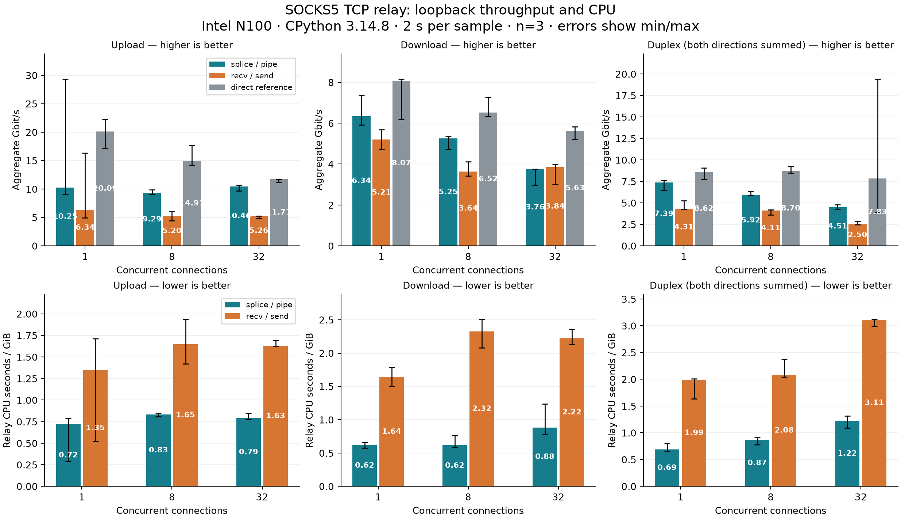

# TCP 吞吐与 CPU benchmark

2026-10-07。当前默认 splice 实现相对于对照 recv/send relay 的主要收益是减少中继 CPU。
主矩阵中，每 GiB CPU 时间的中位数减少 **47%–73%**；
单连接上传/下载分别为 **10.25 / 6.34 Gbit/s**，单连接双向合计 **7.39 Gbit/s**。
32 路下载为 3.76 vs 3.84 Gbit/s，吞吐基本相当；不能认为 splice 在所有场景都更快。

这是本机回环的观测值。单连接上传和直连部分样本波动较大，延长到 5 秒也未完全消除；
因此采用中位数并保留范围，不把一次峰值当作固定性能。



[原始 81 次数据](benchmark-results.json) · [汇总](benchmark-summary.json) ·
[18 次长窗口复测](benchmark-followup.json) · [矢量图](benchmark.svg)

## 测量环境与方法

- Intel N100，4 个可用 CPU；Linux 6.12.111+deb13-cloud-amd64；CPython 3.14.8。
- 默认 `_UnixSelectorEventLoop`，关闭 asyncio debug；不使用 uvloop 或原生扩展。
- 中继进程固定 CPU 0，上游测试服务 CPU 1，客户端发生器 CPU 2。
  单独记录中继进程的 user+system CPU 时间，发生器 CPU 不计入该数值。
- 主矩阵：上传/下载/双向 × 1/8/32 连接 × direct/splice/copy × 3 次，共 81 次。
  随机打乱顺序；每次使用新中继进程，先以独立连接预热 0.25 秒，再做 2 秒数据传输。
  握手、callback 和建连在计时前完成，最终排空和连接清理计入耗时；测量连接重新建立，
  因此包含其 TCP 缓冲自适应阶段，不是无限长连接的稳定峰值测量。
- 对照使用相同的 SOCKS5 服务器、握手、callback、连接生命周期和 raw socket。
  唯一替换的数据面为 64 KiB `sock_recv`/`sock_sendall`，同样按名义 256 KiB 字节预算
  和 8 次操作预算让出循环；sock I/O 内部可能进行额外系统调用。
  替换只在 benchmark 子进程中发生，生产代码与默认配置未改动。
- splice 每方向 pipe 容量实测 65536 字节；采用当前默认 256 KiB/8 调度预算。
  socket 使用系统默认/自动调整缓冲，不改 sysctl、pipe 大小或生产 socket 选项。
- 上游是独立的受控 SOCKS5 流量服务，生成/消费 payload，不经过额外真实目标连接。
  这次性能测试没有包含 Xray/V2Fly/SS 的加密、DNS 或转发开销。
- 每个流由双方核对发送/接收字节计数，并检查接收段首尾 64 字节。
  性能窗口不做全量 hash；payload 的完整正确性另由 TCP 测试覆盖。
- 吞吐是有效 payload 总字节数 ÷ 完成时间，排除基准控制头/统计尾。
  双向为上传与下载相加，每个方向的字节只计一次，不重复计算两个 TCP hop。
- CPU 100% 表示使用一个 CPU 核心。CPU 秒/GiB 能比较不同吞吐下的效率；
  p99 是中继进程内 5 ms 周期定时器的迟到时间，不是网络 RTT。
- 图中柱为三次中位数，误差线为最小/最大值；不是置信区间。

## 吞吐

| 场景 | 连接数 | splice Gbit/s（范围） | recv/send Gbit/s（范围） | 直连参考 Gbit/s |
| --- | ---: | ---: | ---: | ---: |
| 上传 | 1 | 10.25（9.09–29.34） | 6.34（4.95–16.32） | 20.09 |
| 上传 | 8 | 9.29（9.07–9.87） | 5.20（4.43–6.05） | 14.91 |
| 上传 | 32 | 10.46（9.67–10.68） | 5.26（4.88–5.27） | 11.71 |
| 下载 | 1 | 6.34（5.91–7.37） | 5.21（4.72–5.68） | 8.07 |
| 下载 | 8 | 5.25（4.72–5.34） | 3.64（3.42–4.12） | 6.52 |
| 下载 | 32 | 3.76（2.98–3.76） | 3.84（3.01–4.00） | 5.63 |
| 双向合计 | 1 | 7.39（6.51–7.63） | 4.31（4.27–5.24） | 8.62 |
| 双向合计 | 8 | 5.92（5.88–6.32） | 4.11（3.60–4.20） | 8.70 |
| 双向合计 | 32 | 4.51（4.29–4.79） | 2.50（2.46–2.85） | 7.83 |

直连绕过中继，但仍使用同一 SOCKS 流量发生器和测试服务。
它是参考，不能当严格上限：额外缓冲和反压会改变发生器的运行节奏。
若干下载/双向样本中发生器接近占满其 CPU，而中继尚未满载；数据包含这种限制。

## 中继 CPU

| 场景 | 连接数 | splice CPU 秒/GiB | recv/send CPU 秒/GiB | CPU 用量减少 | 中继 CPU %（splice / copy） |
| --- | ---: | ---: | ---: | ---: | ---: |
| 上传 | 1 | 0.718 | 1.349 | 47% | 85.7 / 99.6 |
| 上传 | 8 | 0.834 | 1.649 | 49% | 91.9 / 99.8 |
| 上传 | 32 | 0.790 | 1.627 | 51% | 96.2 / 99.6 |
| 下载 | 1 | 0.621 | 1.636 | 62% | 45.8 / 99.2 |
| 下载 | 8 | 0.618 | 2.324 | 73% | 36.2 / 99.8 |
| 下载 | 32 | 0.883 | 2.223 | 60% | 38.7 / 99.0 |
| 双向合计 | 1 | 0.689 | 1.991 | 65% | 59.3 / 99.8 |
| 双向合计 | 8 | 0.867 | 2.084 | 58% | 59.8 / 99.7 |
| 双向合计 | 32 | 1.220 | 3.114 | 61% | 65.7 / 90.6 |

recv/send 中继在多数场景接近占满单核心；splice 的收益在 CPU 秒/GiB 上更明显。
这里只比较这两种实际 Python 实现，不声称此差异仅来自一次内存复制，
也不把 CPU 用量减少直接等同于端到端吞吐增长。

## 事件循环延迟

| 场景 | 连接数 | splice p99 ms | recv/send p99 ms |
| --- | ---: | ---: | ---: |
| 上传 | 1 | 4.43 | 1.21 |
| 上传 | 8 | 7.36 | 5.20 |
| 上传 | 32 | 4.73 | 15.62 |
| 下载 | 1 | 4.28 | 2.00 |
| 下载 | 8 | 1.74 | 9.30 |
| 下载 | 32 | 3.06 | 19.26 |
| 双向合计 | 1 | 2.19 | 2.30 |
| 双向合计 | 8 | 3.46 | 10.53 |
| 双向合计 | 32 | 7.85 | 26.55 |

多连接场景中 splice 通常延迟更低；单连接及 8 路上传并非全部占优。
这是流量负载下的本机调度观测，不保证其他业务 callback 的响应时间。

## 5 秒窗口复测

对首轮波动较大的单连接上传和 32 路双向追加三次/后端，共 18 次：

| 场景 | 后端 | Gbit/s 中位数（范围） | CPU 秒/GiB 中位数 |
| --- | --- | ---: | ---: |
| 上传，1 连接 | splice | 10.99（8.96–26.04） | 0.727 |
| 上传，1 连接 | copy | 5.75（5.65–8.42） | 1.484 |
| 上传，1 连接 | direct | 14.87（11.12–15.23） | 0.000 |
| 双向合计，32 连接 | splice | 4.99（4.16–9.47） | 1.208 |
| 双向合计，32 连接 | copy | 2.85（1.87–3.02） | 2.874 |
| 双向合计，32 连接 | direct | 6.52（5.83–7.33） | 0.000 |

长窗口仍有明显波动，无法把波动原因归因于单一因素；没有做独占 CPU 隔离、
固定频率或控制其他系统负载。复测继续支持中继 CPU 效率的优势，
但不支持拿某次峰值作实际网卡吞吐承诺。

## 复现

```bash
uv run python tools/benchmark_tcp.py \
  --seconds 2 --repeats 3 --concurrency 1 8 32 \
  --output-dir /absolute/path/to/results

uv run python tools/benchmark_tcp.py \
  --seconds 5 --repeats 3 --concurrency 1 --directions upload \
  --output-dir /absolute/path/to/upload-followup

uv run python tools/benchmark_tcp.py \
  --seconds 5 --repeats 3 --concurrency 32 --directions duplex \
  --output-dir /absolute/path/to/duplex-followup
```

工具只使用回环网络，临时子进程结束后回收。每次中继测量结束活跃会话均为 0，
本次中继 FD 数均恢复为 8（包含事件循环、监听与基准控制 FD）。
运行时没有增加第三方依赖；绘图在单独的临时 matplotlib 环境进行。
本次不测 GPU、UDP、连接建立速率、真实 NIC 或长期生产负载。
